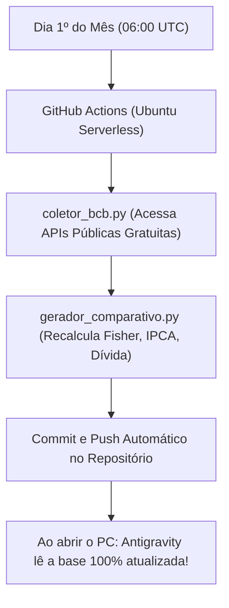

# 🏛️ Observatório Macro Brasil (2003 - Presente)
### Monitoramento Estratégico Autônomo de Políticas Públicas, Economia e Governança

---

## 🎯 1. O Que É Este Sistema?
Um ecossistema completo de inteligência governamental e macroeconômica, desenhado para rodar de forma **100% autônoma**, **gratuita** e **sem depender de nenhuma API paga (como OpenAI ou Gemini API)**.

O observatório documenta, cruza e analisa matematicamente os mandatos presidenciais de:
* **Lula 1 e 2 (2003 - 2010)**
* **Dilma Rousseff 1 e 2 (2011 - 2016)**
* **Michel Temer (2016 - 2018)**
* **Jair Bolsonaro (2019 - 2022)**
* **Lula 3 (2023 - 2026 / Presente)**

Todas as métricas são extraídas diretamente das fontes primárias oficiais:
* **Banco Central do Brasil (SGS - Sistema Gerenciador de Séries Temporais)**
* **Instituto Brasileiro de Geografia e Estatística (IBGE / SIDRA / PNAD Contínua)**
* **Tesouro Nacional e Ministério da Fazenda**

---

## 🛰️ 2. Como Funciona com o PC Desligado? (Automação Perpétua)

O grande segredo técnico desta arquitetura é a dissociação entre a **coleta contínua (na nuvem)** e a **análise estratégica (no Antigravity)**:



1. **Zero Custo de API:** A API do Banco Central do Brasil (`api.bcb.gov.br`) é pública, aberta e não requer login, token nem pagamento.
2. **Independência do Computador:** O arquivo `.github/workflows/observatorio_mensal.yml` executa nos servidores do GitHub todo dia 1º de cada mês. Ele puxa as novidades, atualiza os dados em JSON e regera o relatório consolidado em Markdown.
3. **Histórico Permanente:** O contexto não é perdido quando a janela de chat fecha ou o computador desliga, pois tudo fica versionado em arquivos físicos no disco.

---

## 📂 3. Mapa de Arquivos

```text
observatorio_brasil/
├── core/
│   ├── coletor_bcb.py              # Script autônomo de coleta das 10 séries do BCB
│   └── gerador_comparativo.py      # Motor de análise estatística e geração de tabelas
├── dados/
│   ├── series_historicas.json      # Série mensal de 2003 até 2026 ponto a ponto
│   └── matriz_comparativa.json     # Métricas consolidadas e ganho real por governo
├── dossie_historico/
│   ├── 01_lula_1_e_2_2003_2010.md  # Relatório aprofundado Lula 1 e 2
│   ├── 02_dilma_1_e_2_2011_2016.md # Relatório aprofundado Dilma Rousseff
│   ├── 03_temer_2016_2018.md       # Relatório aprofundado Michel Temer
│   ├── 04_bolsonaro_2019_2022.md   # Relatório aprofundado Jair Bolsonaro
│   ├── 05_lula_3_2023_presente.md  # Relatório aprofundado Lula 3
│   └── 06_quadro_comparativo_geral.md # Comparativo geral lado a lado com tabelas
├── skills/
│   └── observatorio-gov/
│       └── SKILL.md                # Skill nativa do Antigravity para consultas
└── .github/
    └── workflows/
        └── observatorio_mensal.yml # Automação em nuvem para rodar 4 anos sem PC
```

---

## 📊 4. Principais Indicadores Monitorados

| Indicador | Código SGS/Fonte | O que avalia |
| :--- | :---: | :--- |
| **IPCA Mensal Composto** | 433 | Inflação oficial acumulada de cada período. |
| **Salário Mínimo Real** | 1619 | Ganho real de compra descontando o IPCA pela Fórmula de Fisher. |
| **Dólar Comercial Médio** | 3698 | Variação cambial e pressão sobre insumos importados. |
| **Dívida Bruta (% PIB)** | 13762 | Solvência fiscal e risco-país. |
| **Taxa Selic Média** | 4189 | Custo do crédito e política monetária. |
| **Desemprego (PNAD)** | 24369 | Taxa de desocupação e dinâmica do mercado de trabalho. |
| **Resultado Primário** | 5081 | Superávit ou déficit das contas públicas antes dos juros. |
| **Balança Comercial** | 28526 | Saldo entre exportações e importações em US$ milhões. |

---

## ⚡ 5. Como Usar no Dia a Dia com o Antigravity

Sempre que você quiser saber qualquer coisa sobre política pública, gastos ou economia, basta perguntar diretamente aqui neste chat:
* *"Antigravity, como o poder de compra no governo Bolsonaro se compara ao Lula 1?"*
* *"Qual foi o impacto da dívida pública no governo Dilma vs Lula 3?"*
* *"Me dê um resumo das reformas trabalhista e tributária lado a lado."*
* *"Rode o coletor para ver os números mais recentes do mês."*

O agente acionará a skill `observatorio-gov`, lerá a base de dados oficial e trará respostas fundamentadas em fatos e números, sem paixão e sem achismo.
